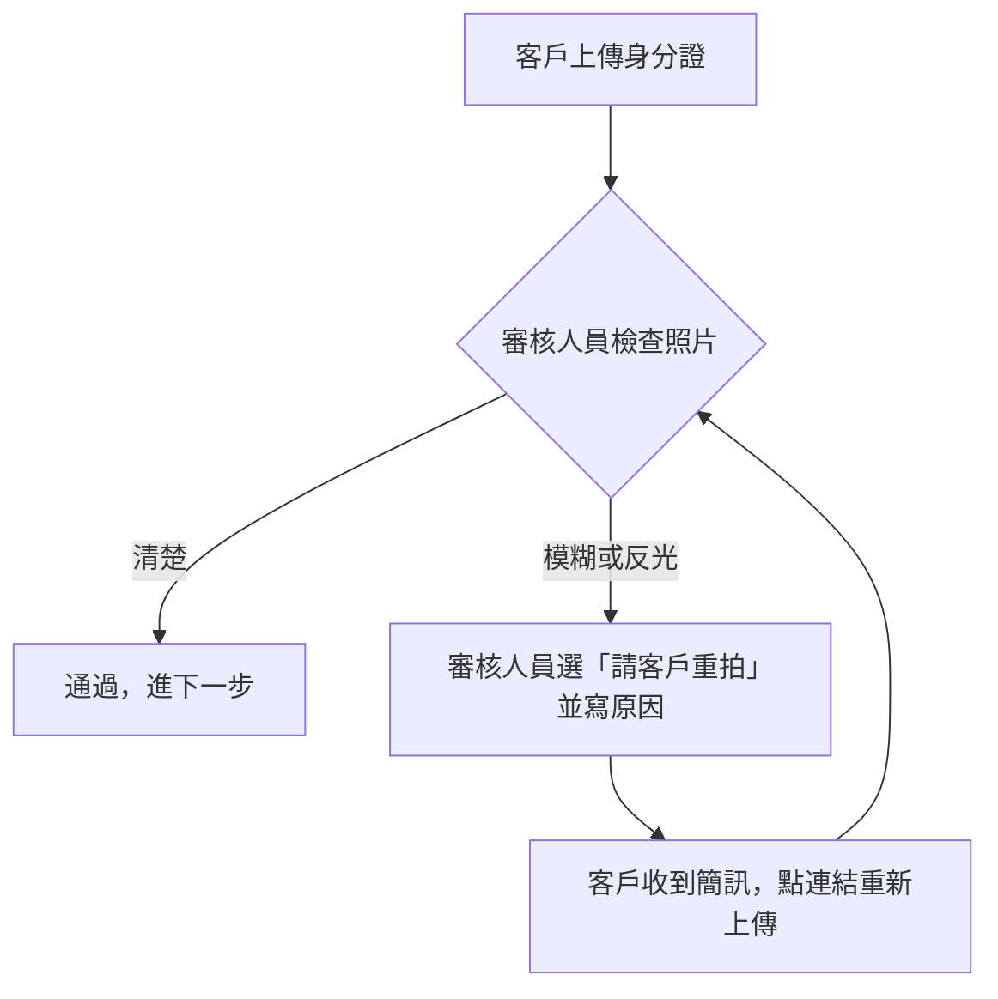

# pm-issue：用 PM 口吻寫需求 issue

讀者是 PM、業務、審核人員、QA、RD。目標只有一個：**讀完的人做得出對的東西，驗收時有明確標準判斷合不合格**。所以重點是「為什麼要做、做完使用者會看到什麼」，不是「系統怎麼實作」。

模板骨架見 `references/template.md`，用詞規則見 `references/wording.md`，兩份都要先讀。

## Step 1：收集需求（一次只問一題）

使用者給的可能是一句話、會議筆記、客戶抱怨、截圖。先自己整理出下面五件事：

1. **誰**遇到問題（客戶、德信審核人員、主管、營業員…）
2. **現在怎樣**、造成什麼後果（流失、客訴、人工多做一步）
3. **希望變成怎樣**
4. **範圍**：哪些情境要改、哪些明確不改
5. **怎樣算成功**：使用者或後台人員會看到什麼

要參考既有 PM 票時用 `glab api "projects/524/issues/<iid>"`（網址的 `work_items/<iid>` 就是 issue iid；`issue-get.sh` 吃不了 work_items 網址）。

**什麼時候問、什麼時候先寫**：「誰」「現在的問題」「希望變成怎樣」缺了就寫不出票，先問，一次一題、附你推測的答案讓使用者選。範圍和成功標準缺了不用停，先照最合理的假設寫進草稿，同時列進 Step 3 待補清單標 ❓ 待確認，讓使用者看草稿時一起決定。

## Step 2：產草稿

照 `references/template.md` 填。三個區塊各自的重點：

- **任務概述**：User Story 一句話（身為…我希望…讓…）；背景講「現在的問題和後果」；範圍要寫「哪些不受影響」。
- **需求**：用 checkbox 分組，每組是一個使用者看得到的改變。寫「後台人員可以選擇寄哪一種信」，不寫「新增 API 參數」。
- **驗收標準**：Given/When/Then 情境，每條 Then 必須是看得到的結果（收到信、畫面顯示什麼、按鈕不能按）。至少包含：
  - 一條主要成功情境（Happy Path）
  - 一條防呆或失敗情境（Negative Path）
  - 一條「其他情境不受影響」的範圍邊界
  - 有留紀錄、寄信、改資料時，加一條資料完整性檢查（可用 checkbox 列，不必寫成 Given/When/Then）

防呆（例如重複送出要二次確認、按取消不送出）使用者沒提也可以寫進草稿，但要同時列進待補清單標 ❓，讓使用者決定留不留。

### 要不要附流程圖

符合任一條就畫：步驟有三步以上、中間有分岔（看情況走不同路）、牽涉兩個以上角色交接。只改文案、顏色、單一按鈕就不畫。

用 Mermaid flowchart（GitLab 會直接畫出圖），節點寫白話動作，不寫系統名詞，放在「需求」區塊開頭的「流程說明」。例：



## Step 3：列待補清單

草稿最後固定附「📎 待補資料」，逐項標 ✅ 已有／⬜ 待補／❓ 待確認：

- Figma 設計稿連結（有畫面改動才需要）
- 現況截圖或錄影（改既有畫面時，附「改之前」最好懂）
- 文案（信件、簡訊、提示訊息、按鈕字）
- 關聯 Epic、Kickoff 日期
- 還沒定案的業務規則

**截圖不能有真實客戶姓名、身分證字號、帳號、Email**，要先遮或用測試資料。使用者給的截圖有個資就提醒，不要上傳。

使用者提供 Figma 連結時，可用 Figma MCP 的 `get_screenshot` 看畫面，核對需求有沒有漏寫畫面上的狀態（空白、錯誤、已完成）。

## Step 4：自我檢查（給使用者看之前）

逐條過一次，不符合就改完再交：

- [ ] 非工程人員讀得懂：對照 `references/wording.md` 的禁用詞，一個都不留
- [ ] 每條需求都對得到至少一條驗收情境；每條驗收情境都對得到需求
- [ ] Then 都是看得到的結果，沒有「系統正確處理」這種驗不了的句子
- [ ] 範圍邊界寫了「哪些不改」
- [ ] 沒有幫業務做未經確認的決定

把草稿和待補清單一起給使用者，問：待補的要先補，還是先開票之後再補？

## Step 5：建立 GitLab issue（使用者確認後才做）

預設建在 rsc-pm。project 參數一定給字面路徑，不給 524、不用 shell 變數（寫入白名單會擋）：

```bash
# 先把內文寫到 scratchpad，再 dry-run
~/.claude/scripts/gitlab/issue-create.sh fugle/brokerage-service-development/r-securities/rsc-pm "<標題>" \
  --description "$(cat <scratchpad>/pm-issue-draft.md)" \
  --labels "# type::feature,\$ priority::2,RSC-JI,product::account-system" --dry-run 2>/dev/null
```

- 草稿檔只放 issue 內文；標題和 labels 寫在對話裡給使用者看，不要放進草稿檔開頭（整個檔案會被當成內文送出）
- 標題格式：`[開戶]` 或 `[後台]` 前綴＋一句白話講「改成怎樣」，例：`[後台] 身分證照片不清楚時可請客戶重拍，不必整件退件`
- 前綴、type、priority 的選法見 `references/template.md` 末段；不確定 priority 就問
- dry-run 給使用者看過再拿掉 `--dry-run` 真建。輸出的 stderr 第一行是白名單提醒，用 `2>/dev/null` 丟掉再解析
- 建完用回傳的 iid 跑 `glab api "projects/524/issues/<iid>"` 重查，確認標題、labels、內文長度對得上，才回報網址

改既有 PM 票時，先把原本的 JSON 存到 scratchpad 備份，再用 `issue-update.sh` 寫入，寫完重抓核對。
