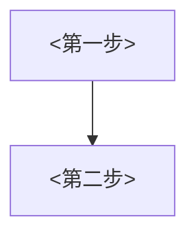

# PM issue 模板

骨架取自 rsc-pm#201。區塊標題和 emoji 照抄，讓整個 rsc-pm 的票長得一樣。`<>` 是要填的地方；用不到的欄位寫「無」，不要刪掉。

````markdown
## 📝 任務概述 (Objective)
- **User Story:** 身為<誰>，我希望<能做什麼>，讓<得到什麼好處>。
- **背景:** <現在怎麼運作> → <造成什麼問題或後果（流失、客訴、人工多一步）>。
- **範圍:** <這次只改哪些情境>；<哪些維持現狀>。
- **關聯 Epic:** <連結或「無」>
- [ ] **Kickoff:** - 已開 (YYYY-MM-DD)

---

## 🎨 需求
- **Figma 畫板:** <連結，沒有就寫「待補 🔗」；沒有畫面改動寫「不需要」>
- **流程說明:**（符合畫圖條件才放，見 SKILL.md）



- **<改變一，用使用者看得到的結果命名>:**
    - [ ] <具體行為>
    - [ ] <具體行為>
- **<改變二>:**
    - [ ] <具體行為>
        - **<選項 A>**：<什麼情況用>
        - **<選項 B>**：<什麼情況用>
- **文案:**
    - [ ] <哪段文案>（待提供／已附）

---

## ✅ 驗收標準 (Acceptance Criteria)

### 情境 1：<一句話講情境>（Happy Path）
- **Given:** <前提：誰、在什麼狀態>
- **When:** <做了什麼>
- **Then:** <看到什麼結果>

### 情境 2：<防呆或失敗>（Negative Path）
- **Given:**
- **When:**
- **Then:**

### 情境 N：<其他情境>不受影響
- **Given:** <範圍外的情境>
- **When:** <照常操作>
- **Then:** 維持現有流程，不受本次調整影響

### 情境 N+1：資料完整性（有留紀錄、寄信、改資料才需要）
- [ ] <哪些資料要正確留下>
- [ ] <不會發生哪種錯誤，例如寄錯對象、寄錯類型>

---

## 📎 待補資料
| 項目 | 狀態 | 說明 |
| --- | --- | --- |
| Figma 設計稿 | ⬜ 待補 | |
| 現況截圖 | ✅ 已有 | 已遮個資 |
| <文案名稱> | ⬜ 待補 | |
| <未定案的規則> | ❓ 待確認 | <要誰決定> |
````

## 寫法提醒

- 驗收情境的編號跟標題要能單獨引用（「情境 4 沒過」大家就知道是哪條）。
- Then 寫具體畫面或訊息，例：「顯示『此案件已於 YYYY-MM-DD 寄送 [信件類型]』的二次確認」，不寫「顯示提示」。
- 兩種選項的差別用「什麼情況用哪個」講，不要只列名稱。

## rsc-pm labels

字串含前綴符號，要完全照抄：

| 用途 | 選項 |
| --- | --- |
| 類型（擇一） | `# type::feature` 多了以前做不到的操作或畫面；`# type::improvement` 既有流程的規則或行為改變；`# type::UX` 只改外觀、文字、位置，流程不變；`# type::bug` 跟原本設計不符；`# type::data-fix` 修正已存在的錯誤資料 |
| 優先度（擇一） | `$ priority::0` 最急 ～ `$ priority::3` 不急；不確定就問 |
| 產品 | 開戶系統 `product::account-system`；吉盈 `product::just-invest` |
| 團隊 | `RSC-JI` |

標題前綴看「要做的操作或畫面在哪邊」：客戶的開戶流程畫面用 `[開戶]`，德信內部審核後台用 `[後台]`。客戶只是收到的信或簡訊不同、操作都在後台時，用 `[後台]`。兩邊都有新畫面就各開一張，或用主要那邊並在範圍寫清楚。
